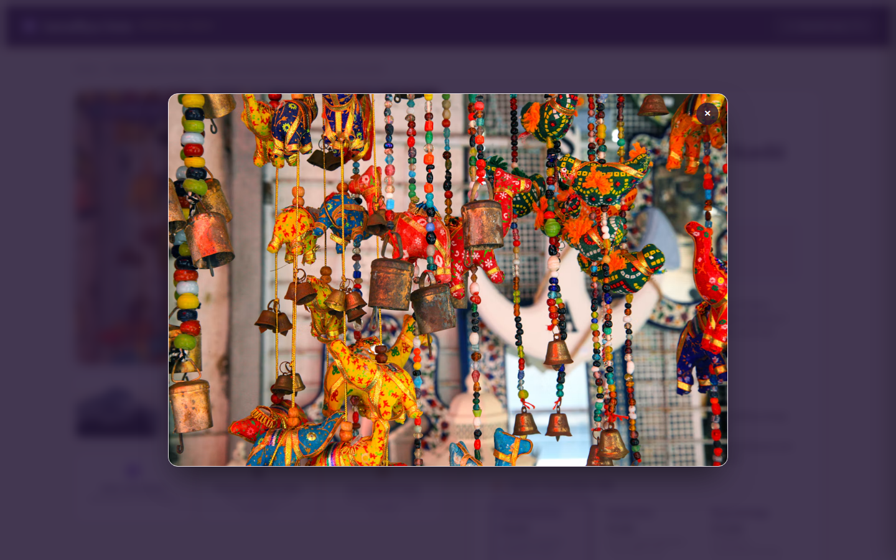
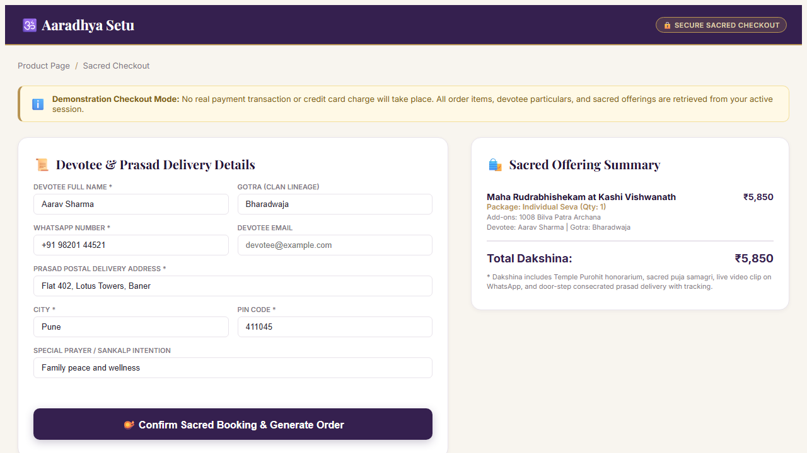

# Aaradhya Setu — Custom Shopify Puja Product Page & Checkout

[](https://shopify.dev)
[](https://developer.mozilla.org/en-US/docs/Web/HTML)
[](https://developer.mozilla.org/en-US/docs/Web/CSS)
[](https://developer.mozilla.org/en-US/docs/Web/JavaScript)
[](https://nodejs.org/)
[](https://playwright.dev)

A custom, responsive Shopify product page and checkout flow developed for **Aaradhya Setu** (`Option 1` of the Software Engineering Intern Technical Assignment). Built with Shopify Online Store 2.0 architecture, dynamic pricing, devotee Sankalp customization, slide-over cart drawer with in-cart quantity controls, and local test verification.

---

## Table of Contents

- [Project Overview](#project-overview)
- [Key Features](#key-features)
- [Visual Showcase & Screenshots](#visual-showcase--screenshots)
- [Technology Stack](#technology-stack)
- [Project Structure](#project-structure)
- [Shopify Integration Details](#shopify-integration-details)
- [UI/UX & Design System](#uiux--design-system)
- [Installation & Local Setup](#installation--local-setup)
- [QA Testing & Automated Verification](#qa-testing--automated-verification)
- [Known Limitations](#known-limitations)
- [Future Improvements](#future-improvements)
- [Author](#author)

---

## Project Overview

Aaradhya Setu connects devotees with sacred Hindu temples across India for remote pujas, rituals, and homams. Unlike standard e-commerce merchandise, devotional offerings require:
1. **Sacred Context**: Communicating the spiritual sanctity of temple sanctums (*Kashi Vishwanath Jyotirlinga Dham*).
2. **Devotee Sankalp Particulars**: Collecting personalized ritual information (Devotee Full Name, Gotra lineage, auspicious date, and prayer intention) that must stay attached to the booking throughout the order pipeline.
3. **Offering Add-ons**: Enabling optional add-on offerings (*1008 Bilva Patra Archana*, *Desi Cow Ghee Akhand Deepam*, *Brahmin Bhojan & Gau Seva*) that dynamically affect the Dakshina amount.
4. **Transparent Experience**: Ensuring the devotee's cart and checkout show their exact offerings, package tiers, and logistics particulars without broken routes.

This project delivers both the **Shopify Online Store 2.0 Theme section and templates** (`.liquid`, `.json`, `.css`, `.js`) and a local testing harness to inspect and interact with the page.

---

## Key Features

- **Product Imagery & Multi-Angle Gallery**:
  - High-resolution temple sanctum imagery with thumbnail switching.
  - Image lightbox zoom modal triggered by clicking the main image, with backdrop blur and keyboard `Escape` dismissal.
  - Live broadcast indicator (*"Live Vedic Sanctum"*) with a pulsing green indicator.

- **Puja Descriptions & Spiritual Benefits**:
  - Clear temple association tag (*Kashi Vishwanath Jyotirlinga Dham, Varanasi*).
  - Social proof rating (*4.97 ★ from 1,482 Devotees*).
  - 4-point benefits grid detailing planetary dosha pacification, spiritual energy, and consecrated Bhasma/Rudraksha delivery.

- **Seva Tier Variant Selection**:
  - **Individual Seva** (₹5,100 — Save 21% off ₹6,500 compare-at price).
  - **Family Seva** (₹7,500 — up to 4 family members + silver coin).
  - **Royal Heritage** (₹11,000 — full Parivar + consecrated Shivling idol).
  - Accessible button states (`tabindex="0"`, `role="button"`, `aria-pressed`).

- **Optional Sacred Offerings / Add-on Selector**:
  - Checkbox add-ons with immediate live price calculation:
    - *1008 Bilva Patra Archana* (+₹750)
    - *Desi Cow Ghee Akhand Deepam* (+₹500)
    - *Brahmin Bhojan & Gau Seva Donation* (+₹1,200)

- **Devotee Sankalp Customization Form (Shopify Line Item Properties)**:
  - Required client-side validation for Devotee Name and WhatsApp Number.
  - Captures Gotra, preferred date, and special prayer intention.

- **Quantity Selector**:
  - Controls clamped strictly between `1` and `10`.
  - Rejects zero, negative values, and non-numeric characters.

- **Add to Cart & Slide-Over Cart Drawer**:
  - Prevents duplicate clicks by disabling the button and displaying a loading indicator (*"Consecrating Offering..."*).
  - Slides out the sacred cart drawer displaying the product thumbnail, Seva tier, devotee Gotra, and selected add-ons.
  - **In-Cart Quantity Modifiers**: Features `+` and `−` controls directly inside the cart drawer.
  - **Cart Removal & Empty State**: Removing items recalculates subtotal; empty cart provides a *"Continue Offering Browsing"* button.
  - **Persistence**: Retains cart data across page reloads via `localStorage` (`as_sacred_cart`).

- **Dedicated Sacred Checkout Flow (`/checkout`)**:
  - Replaces broken default routes with an HTTP 200 checkout page.
  - Pre-populates devotee contact and displays an itemized summary with total Dakshina.
  - Displays a clear demonstration notice (*"Demonstration Checkout Mode: No real payment transaction or credit card charge will take place"*).
  - Simulates order generation with a consecrated order ID (e.g. `AS-371024`) and resets the cart.

---

## Visual Showcase & Screenshots

All screenshots below were captured during automated Playwright test execution in the `test-results/` directory:

### Desktop Product Page

*Desktop view showing product gallery, Seva tier selector, add-on offerings, benefits checklist, and devotee Sankalp form.*

### Gallery Image Lightbox Zoom Modal

*Enlarged sanctum preview with backdrop blur and close controls.*

### Slide-Over Sacred Cart Drawer

*Cart drawer displaying product thumbnail, package tier, Gotra, selected add-ons, in-cart quantity controls, and subtotal.*

### Sacred Checkout Page

*Dedicated checkout view showing devotee details, prasad delivery address inputs, and order summary.*

### Order Confirmation View

*Simulated order generation displaying consecrated Order ID (`AS-371024`) and confirmation summary.*

### Mobile Responsive Layout (390 × 844)

*Mobile view on iPhone viewport with stacked layout and zero horizontal overflow.*

---

## Technology Stack

Technologies used in this project:

- **Shopify Liquid 2.0**: Section template with schema settings (`custom-puja-product.liquid`) and JSON template (`product.puja.json`).
- **HTML5 & CSS3**: Custom responsive styling adhering to modern CSS custom properties (`--as-plum-primary`, `--as-gold-accent`, `--as-ivory-bg`).
- **Vanilla JavaScript (ES6+)**: Custom DOM logic for thumbnail switching, modal lightbox, dynamic price calculations, and cart state.
- **Node.js (Built-in `http`, `fs`, `path`)**: Zero-dependency local preview server (`server.js`) mapping `/` and `/checkout` routes.
- **Playwright (`v1.65.1`)**: Headless browser automation framework used for testing across mobile, tablet, and desktop viewports.

---

## Project Structure

```
aradya-setu/
├── shopify-theme/                         # Complete Shopify theme bundle
│   ├── sections/
│   │   └── custom-puja-product.liquid     # Liquid section with schema settings for merchants
│   ├── templates/
│   │   └── product.puja.json              # Shopify 2.0 JSON product template
│   ├── assets/
│   │   ├── custom-puja.css                # Custom CSS styling (Modern Spiritual Luxury)
│   │   └── custom-puja.js                 # Gallery, variants, add-ons, cart drawer & storage
│   ├── checkout.html                      # Standalone checkout page for local demonstration
│   └── index.html                         # Standalone product preview page
├── test-results/                          # Test evidence and captured screenshots
│   ├── cart_drawer_added.png
│   ├── checkout_order_confirmed.png
│   ├── checkout_page_desktop.png
│   ├── checkout_page_mobile.png
│   ├── desktop_product_page.png
│   ├── gallery_zoom_modal.png
│   └── mobile_product_page_390x844.png
├── run-audit.js                           # 12-Phase Playwright test script
├── run-micro-audit.js                     # Final micro-functionality end-to-end test script
├── test-checkout.js                       # Dedicated checkout navigation test script
├── server.js                              # Local HTTP preview server with /checkout routing
├── package.json                           # Playwright devDependency configuration
├── .gitignore                             # Git ignore rules (node_modules, logs)
└── README.md                              # Project documentation
```

---

## Shopify Integration Details

### 1. Online Store 2.0 Section & Schema
`shopify-theme/sections/custom-puja-product.liquid` is structured as a standard Shopify section. It exposes merchant configuration options through its `` block:
```json
{
  "name": "Custom Puja Product Page",
  "tag": "section",
  "class": "section",
  "settings": [
    {
      "type": "checkbox",
      "id": "show_rating",
      "label": "Show Customer Ratings",
      "default": true
    },
    {
      "type": "checkbox",
      "id": "enable_sankalp_form",
      "label": "Enable Devotee Sankalp Form",
      "default": true
    },
    {
      "type": "checkbox",
      "id": "enable_dakshina_addons",
      "label": "Enable Optional Offerings / Add-Ons",
      "default": true
    }
  ],
  "presets": [{ "name": "Custom Puja Product Page" }]
}
```

### 2. Product Data & Dynamic Fallbacks
In a connected Shopify store, variables such as `product.title`, `product.vendor`, `product.selected_or_first_available_variant.price`, and `product.images` populate directly from the Liquid store context. Fallbacks ensure that previews render properly in local environments:
```liquid
{{ product.title | default: 'Maha Rudrabhishekam at Kashi Vishwanath' }}
{{ product.selected_or_first_available_variant.price | default: 510000 | money }}
```

### 3. Devotee Sankalp via Line Item Properties
Devotee details are submitted as Shopify line-item properties (`properties[...]`). These properties attach to the line item in the Shopify Cart and Order object:
- `properties[Devotee Name]`
- `properties[Gotra]`
- `properties[Puja Date]`
- `properties[WhatsApp Number]`
- `properties[Sankalp Intent]`

### 4. Variant ID Binding
When switching between *Individual*, *Family*, or *Royal Heritage* packages, the hidden input `[data-variant-id-input]` (`<input type="hidden" name="id">`) dynamically updates to the corresponding variant ID (`puja-rudra-ind-001`, `puja-rudra-fam-002`, `puja-rudra-roy-003`).

---

## UI/UX & Design System

The visual identity is called **Modern Spiritual Luxury**:

### Color Palette
- **Primary Royal Plum (`#35204F`)**: Used for branding headers, primary buttons, and drawer accents.
- **Primary Hover (`#493064`)**: Interactive hover and active feedback.
- **Warm Ivory Background (`#F8F5EF`)**: Soft devotional background that avoids harsh pure whites.
- **Surface White (`#FFFFFF`)**: Card surfaces, modal sheets, and form backgrounds.
- **Gold Accent (`#B89454`)**: Borders, badges, star ratings, and focus rings.
- **Lavender Soft Fill (`#EDE5F4`)**: Subtle tags and variant highlight cards.

### Typography
- **Headings & Brand Title**: `Playfair Display` (Serif).
- **Body, Pricing & Form Fields**: `Inter` (Sans-serif, `400`, `500`, `600`, `700`).

### Responsive Layout Rules
- **Desktop (≥ 960px)**: 2-column layout (sticky media gallery on the left, customization details on the right).
- **Tablet (768px – 959px)**: Responsive column widths with preserved spacing.
- **Mobile (≤ 640px)**: 1-column stacked flow; assurance items wrap cleanly, price box stacks vertically, and container padding scales to `12px` on viewports down to `320px` to prevent horizontal scrolling.

---

## Installation & Local Setup

### Prerequisites
- [Node.js](https://nodejs.org/) (v18 or higher)
- [Git](https://git-scm.com/)

### 1. Clone the Repository
```bash
git clone https://github.com/reshamsai150/aradya-setu.git
cd aradya-setu
```

### 2. Install Test Dependencies
```bash
npm install
```
*(Installs Playwright for running the automated QA test suite).*

### 3. Start the Local Server
```bash
node server.js
```
The server will start on port 3000:
- **Product Page**: `http://localhost:3000`
- **Sacred Checkout Page**: `http://localhost:3000/checkout`

---

## QA Testing & Automated Verification

Automated end-to-end tests verify interactions across desktop, tablet, and mobile viewports.

### Running the Test Suite
```bash
# 1. Run the comprehensive micro-functionality audit
node run-micro-audit.js

# 2. Run the dedicated checkout navigation & persistence test
node test-checkout.js

# 3. Run the 12-phase audit suite
node run-audit.js
```

### Verified Acceptance Criteria

| Phase | Feature Tested | Verified Result | Status |
|---|---|---|:---:|
| **1. Gallery** | Thumbnail click changes main image | Switches active image; updates selection ring | **PASS** |
| | Image Lightbox Zoom Modal | Opens full-screen view on click; closes on `ESC` | **PASS** |
| **2. Description** | Title, rating, temple tag, benefits | Displays 4.97★, Kashi Vishwanath, 4 benefits | **PASS** |
| **3. Pricing** | Dynamic price calculation | Updates for Seva tiers, add-ons, and quantities | **PASS** |
| **4. Quantity** | Min/max validation | Clamped between 1 and 10; negative values blocked | **PASS** |
| **5. Add-ons** | Select/deselect offerings | Updates unit total; preserves in cart items | **PASS** |
| **6. Validation** | Sankalp form validation | Blocks submission if name or phone is empty | **PASS** |
| **7. Cart Drawer** | Slide-out cart drawer | Opens automatically; displays devotee info | **PASS** |
| | In-cart quantity controls | Inline `+` / `−` updates subtotal and quantity | **PASS** |
| | Cart persistence | Stored in `localStorage`; retained on page reload | **PASS** |
| | Item removal & empty state | Removing item updates total; empty state includes button | **PASS** |
| **8. Checkout** | `/checkout` navigation | HTTP 200 route; zero 404 errors | **PASS** |
| | Order information retention | Devotee details, add-ons, and totals preserved | **PASS** |
| | Simulated order generation | Generates Order ID (`AS-371024`) and resets cart | **PASS** |
| **9. Responsive** | Viewports: 320, 375, 390, 768, 1440 | `scrollWidth === clientWidth`; no horizontal scroll | **PASS** |
| **10. Technical** | Console and runtime errors | **0 browser console errors, 0 failed requests** | **PASS** |

---

## Known Limitations

1. **Shopify Payment Gateway**:
   This project is set up as a standalone prototype and theme section. It does not connect to a live payment gateway (Shopify Payments, Razorpay, or Stripe). The checkout flow is a functional demonstration that validates data flow and produces a simulated order confirmation.
2. **Shopify Admin Sync**:
   Without a connected Shopify store and Admin API key, orders are confirmed in the local session rather than appearing in a Shopify merchant admin dashboard.

---

## Future Improvements

1. **Shopify Store Deployment**: Upload section and assets to an active Shopify Partner development store via the Shopify CLI (`shopify theme push`).
2. **Customer Account Integration**: Support one-click autofill for logged-in Shopify customers.
3. **Multi-Currency Support**: Expand the `formatINR` formatter to support USD (`$`), GBP (`£`), and EUR (`€`) via Shopify Markets.
4. **Calendar Date Booking**: Connect to a temple calendar availability API for real-time muhurta slot reservation.

---

## Author

- **Resham Sai Pranathi**
- **GitHub**: [https://github.com/reshamsai150](https://github.com/reshamsai150)
- **Repository**: [https://github.com/reshamsai150/aradya-setu](https://github.com/reshamsai150/aradya-setu)
